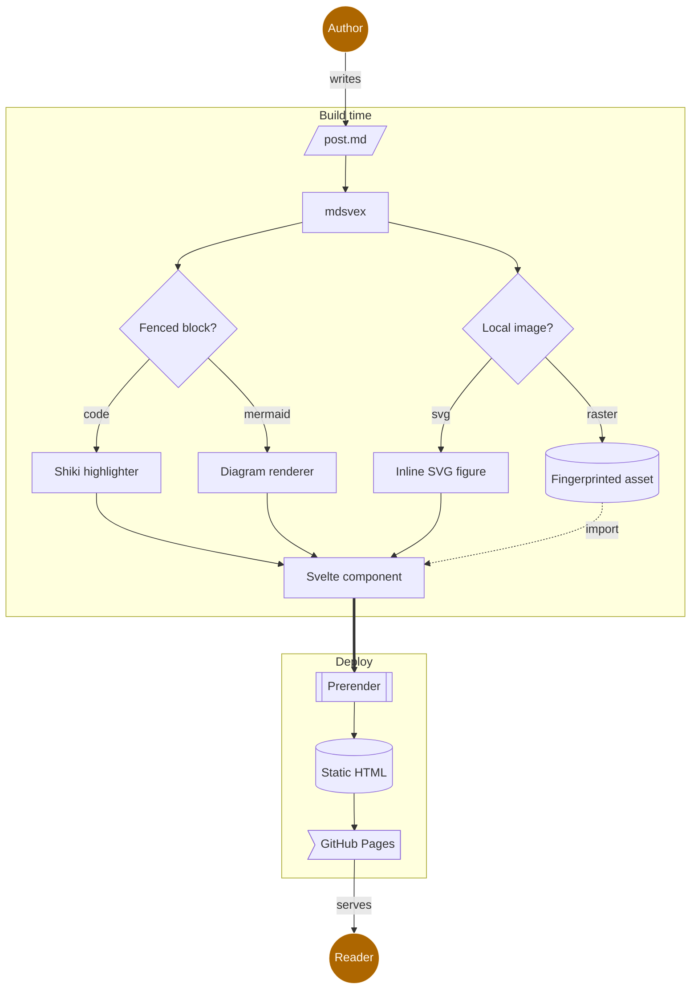
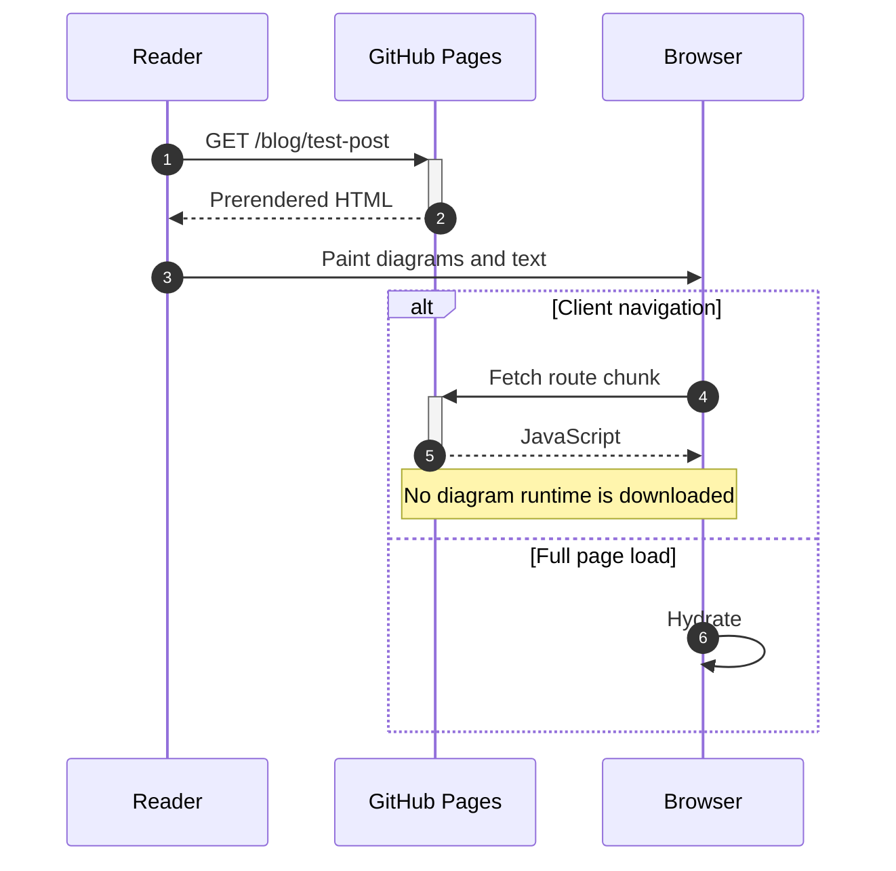
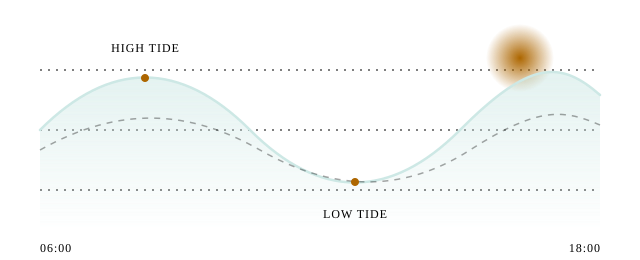

This is a post to test markdown rendering with static sites.
Here's some **bold** text and some _italic_ text.

This is a new paragraph with a link to [svelte.dev](https://svelte.dev).

This paragraph is long enough to push the code block just beyond the screen limit of an iPhone.

```go
package main

import "fmt"

func main() {
    fmt.Println("Hello, World!")
}
```

## Diagrams

Mermaid fences are rendered to SVG at build time, so the page ships no diagram code. This one traces how a post becomes a page.



Sequence diagrams work too, and their markers stay separate from the diagram above.



## Images

An SVG next to the post is inlined, so it can draw with `currentColor` and the site's color tokens.


